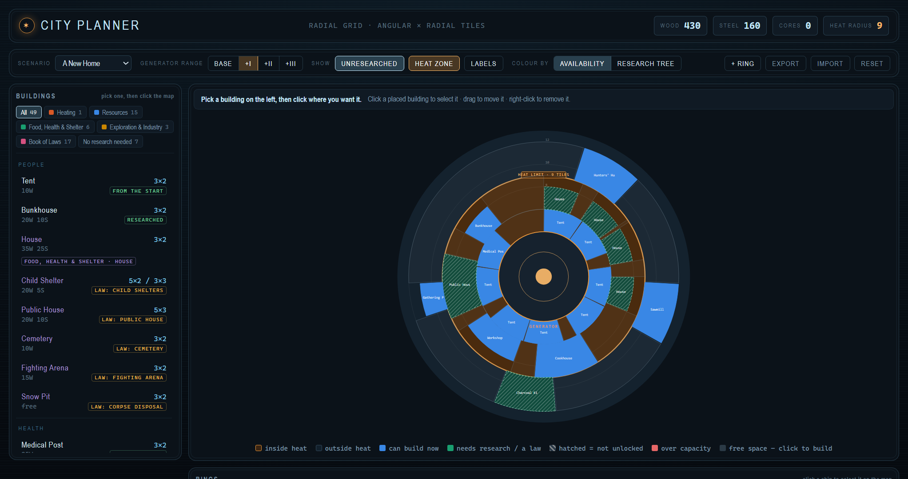

# Frostpunk

A free, spoiler-controlled hint guide for Frostpunk. In this survival city-builder, keep the last city on Earth alive around a coal generator. Your AI agent answers only from the guide files.

## Use it

Install the [reader](https://github.com/hintforge/reader) in any AI agent that can read files on your computer, then tell it:

> Load the Frostpunk guide from github.com/hintforge/frostpunk

Ask about heat, laws or scenarios. The guide uses the [Hintforge](https://github.com/hintforge/builder) format. The agent reads and writes only files you control.

## Spoilers

Threat warnings (Tier 0 to 5) and puzzle or decision warnings (Tier 0 to 3) start silent. Raise a dial to hear more. Late laws and scenario turns stay hidden until allowed. There is no save reader.

## What's inside

- Heat, economy, the Book of Laws, every scenario, law paths, endings and all achievements.
- The full base-game technology tree in [`items/upgrades.md`](items/upgrades.md), with tiers, prerequisites and wood/steel costs.

## City planner

Download [`artifacts/city_planner.html`](artifacts/city_planner.html) and open it in any browser. Nothing is installed or leaves your machine.

Place buildings by angular width and radial depth, reserve space before researching, and see the full research-chain cost and plan total. Filter by Workshop tab. Checking research includes its prerequisites. A labelled heat boundary moves with generator range upgrades.

Layouts are approximate. Ring capacity and base heat radius are derived: the planner matches one community measurement at ring 1 and is up to about 13% pessimistic farther out. Buildings can change size in-game. Trust the game when it fits more; edit derived figures in the Model tab. Details: [`artifacts/README.md`](artifacts/README.md).
